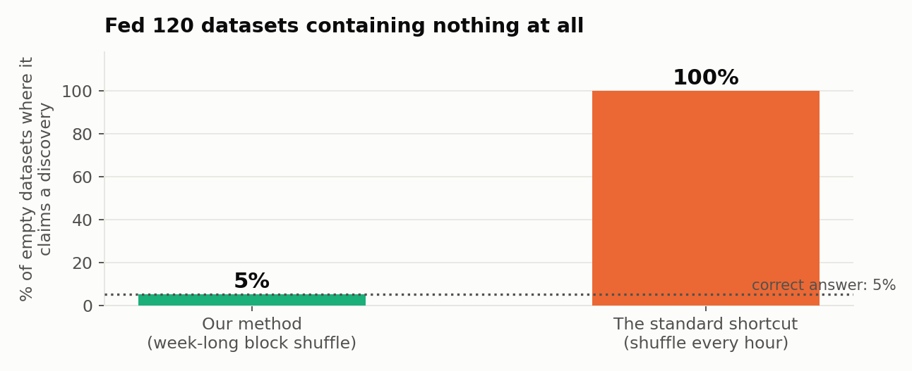
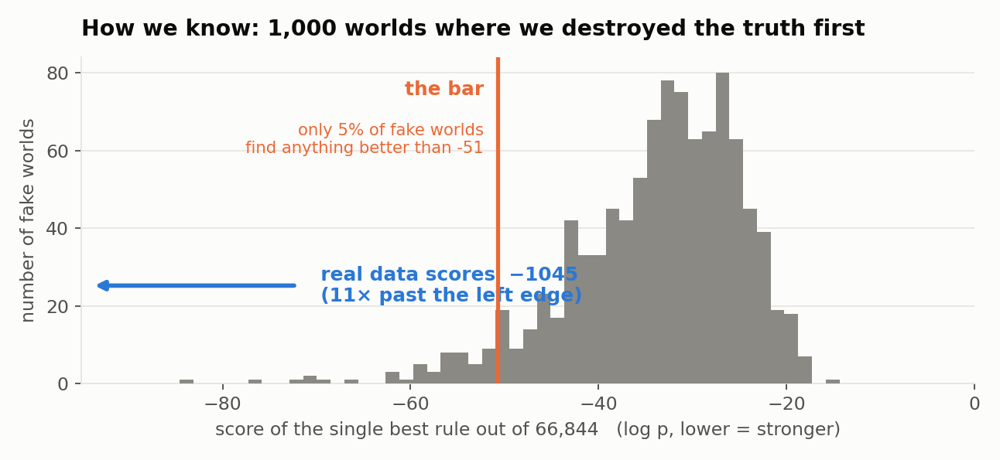
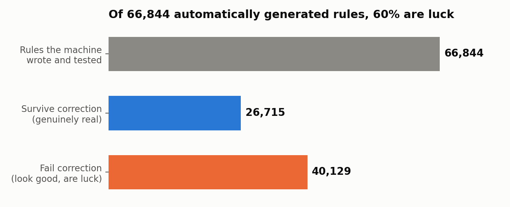
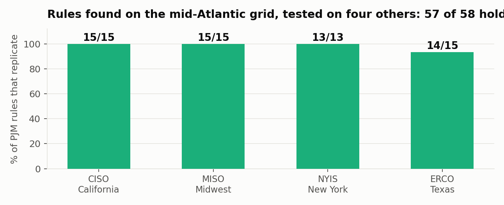
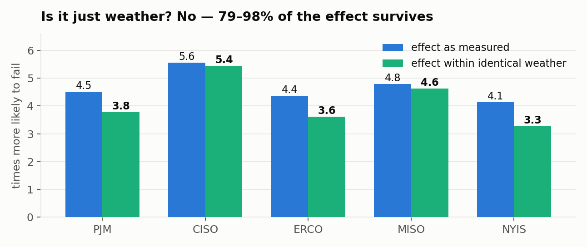
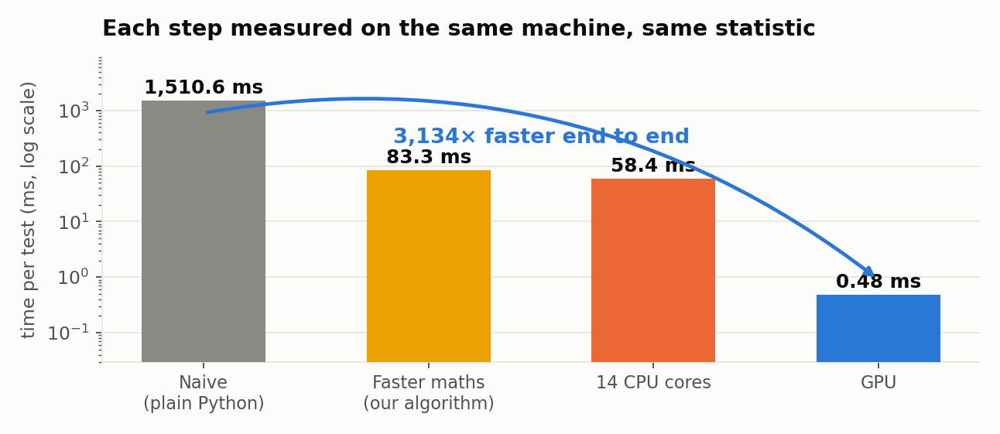

# SIEVE

**Significant pattern mining for autocorrelated time series.**

HackMIT 2026, Voloridge "Signal in the Noise".
Every number in this report traces to a JSON artifact in the repository.
`github.com/HackHeroic/sieve`

---

# 1. The problem, stated precisely

Mine a dataset for patterns and you will find thousands. Most are artifacts of
having looked. The standard defence is multiple-testing correction, and the
standard corrections assume your observations are **independent**.

Hourly data is not independent. Consecutive hours are strongly autocorrelated:
on PJM's forecast-error outcome the lag-1 autocorrelation is **0.654**. Every
analytic p-value computed under an independence assumption is therefore invalid,
and the usual fix -- shuffle the labels and see what chance produces -- is
invalid for the same reason, because shuffling destroys the very structure that
makes chance alignments possible.

**How badly does that matter?** We built 120 datasets containing no signal at
all, by circularly shifting the real outcome away from its true alignment so the
autocorrelation stays real but the relationship is destroyed. Then we ran both
methods on all 120.

| null model | false positive rate |
|---|---|
| naive row shuffle | **1.000** |
| circular block permutation (ours) | **0.058** |

The naive method declares a discovery on **every single one** of 120 datasets
that contain nothing. Ours fires on 7, against a nominal 5%; an exact binomial
test of correct calibration gives **p = 0.672**, and the 95% interval is
[0.024, 0.117], which is simply what n = 120 buys.





*Artifact: `calib_fixed.json`. That is the entire case for the project.*

---

# 2. What SIEVE does

Five decisions. Each one is load-bearing; remove it and something specific
breaks.

**1. Stratify the outcome before searching.** An hour is a failure if its
day-ahead forecast error is in the worst decile *of its own hour-of-day by
calendar-month cell*. Without this you rediscover that summer evenings are hard:
true, known, useless.

**2. Every predicate must be knowable ahead of time.** Only the forecast and
shapes derived from it, realised quantities lagged >= 24h, and calendar terms.
Otherwise you are explaining the past, and the honest answer to "what could the
operator have done?" is "nothing".

**3. Fisher's exact test ranks; it does not decide.** The test gives
p = 1.4e-166 on our top rule. We discard that number as a probability -- it
assumes exchangeable rows -- and use it only to order candidates. All inference
comes from the permutation distribution.

**4. Westfall-Young min-P over the whole lattice.** Per permutation, keep only
the single smallest p across all 66,844 rules. That is the distribution of the
best-looking rule findable in noise. min-P rather than max-T because rules of
different support have Fisher statistics on non-comparable scales.

**5. Circular block permutation, stratified by calendar month.** 168-hour
blocks, exchanged only within the same month. This is what makes the null valid,
and section 1 is what happens without it.

Plus **Tarone's testability bound**, which removes rules that can never reach
the threshold. Measured contribution here: **0.36%**. Reported as a null result
rather than quietly dropped -- our predicates are quantile-based and therefore
dense, so nearly everything is testable.



---

# 3. One rule, end to end

Rule: *the forecast is above median, AND it predicts a top-decile daily swing,
AND yesterday's error was in the worst decile.*

```
                    high-error      normal      total
  rule fires             393          445         838
  rule does not        4,317       41,169      45,486
  total                4,710       41,614      46,324
```

Base rate 10.17%. When the rule fires: **46.90%**. Lift **4.61x**.
Fisher log p = **-381.9**, against an expected count of 85.

The permutation null, 1,000 draws, decides:

```
null minima range      -91.3 .. -17.1
5% cutoff              -51.8
this rule              -381.9        (7x past the bar)
null draws beating it  0  ->  adjusted p = 1/1001 = 0.0010
```

---

# 4. Does the finding hold up?

Four independent attempts to break it. All re-run on the shipped null after an
audit found that earlier versions had used a permutation generator that ignored
stratification.

| test | what it rules out | result |
|---|---|---|
| 120 true nulls | finds things in noise | **0.058** vs naive **1.000** |
| temporal holdout | overfitting the sample | **20 / 20**, lift 4.47 -> **5.18** |
| cross-grid replication | a PJM-specific quirk | **57 / 58** |
| NOAA weather controls | "storms are just hard" | **79% to 98%** retained |

The holdout fits thresholds on 2019-2022 only and tests forward on 2023-01 to
2024-07. The effect got **stronger** out of sample, which is the opposite of the
usual direction.

Replication takes PJM's top 15 rules and tests each against another grid's own
lattice and own null: CISO 15/15, ERCO 14/15, MISO 15/15, NYIS 13/13.





*Artifacts: `calib_fixed.json`, `holdout_clean.json`, `replication_clean.json`.*

---

# 5. Does it generalise beyond one dataset?

The five grids above are five slices of **one** dataset -- same agency, same
schema, same outcome construction. So we pointed the tool at something genuinely
different: **NOAA GHCN-Daily**, Philadelphia, 1970-2026. Different agency,
different domain, **daily instead of hourly**, different schema. No code from the
EIA feature builder was reused; `adapter.py` takes any time-indexed CSV.

It runs, and the rules are physically sensible. Top finding, lift **3.82**:
precipitation yesterday in the top quartile, AND yesterday's maximum temperature
in the top decile, AND the recent persistence error already elevated. That is a
warm wet air mass followed by a frontal passage. Nobody supplied any meteorology.

**But the result that matters is this one:**

| | outcome ACF, lag 1 | naive / block inflation |
|---|---:|---:|
| EIA-930 PJM, hourly | **0.654** | **1.84x** |
| EIA-930 ERCO, hourly | | 4.09x |
| NOAA daily | **0.028** | **1.03x** |

**The correction scales with the dependence it exists to correct for, and
vanishes when that dependence is absent.** On daily weather the outcome is
already nearly white noise, so block permutation and a naive row shuffle agree
to within 3% -- and SIEVE says so. The method does not always disagree with the
naive one. It disagrees exactly when, and in proportion to how much, the naive
assumption is violated.

That is a dose-response relationship, and it is stronger evidence for the
mechanism than any single number.

---

# 6. How much does the answer depend on our choices?

Our null holds calendar month fixed but not year, and PJM's forecast improved
over the sample. So "are you just detecting a year effect?" is a fair question.
The answer is a range, volunteered rather than extracted.

| null specification | blocks per stratum | cutoff | significant |
|---|---:|---:|---:|
| year x month | 4.1 | -158.8 | **7,991** |
| year only | 45.8 | -56.7 | 23,545 |
| **month only (shipped)** | 22.9 | -51.8 | **24,956** |
| unstratified block | 275 | -48.6 | 26,005 |
| *naive row shuffle* | | *-12.9* | *43,559* |

**Range: 7,991 to 26,005**, a factor of 3.3. The finer the stratification, the
fewer blocks are free to move, so the permuted series stays closer to the
original and the bar rises.

**What survives every specification is the comparison itself.** Row shuffle
gives 43,559 regardless, so inflation ranges from 1.7x to **5.5x**, and the
naive method looks *worse* under the conservative specifications, not better.
No choice in that table rescues it.

*Artifact: `sensitivity.json`.*

---

# 7. Significant is not the same as interesting

Lift measures deviation from the base rate, which rewards a rule for restating
its own parts. Following De Bie's FORSIED framework we score instead against a
background model in which the analyst already knows every single-predicate
effect; the maximum-entropy completion of that knowledge is additive in
log-odds, so

```
surprise = logit(observed) - [ logit(p0) + SUM_i ( logit(p_i) - logit(p0) ) ]
```

A rule with high surprise does something its own components do not explain.

| | |
|---|---|
| correlation(lift, surprise) | **-0.073** |
| overlap of top-200 by each | **1 / 200** |
| top-50 most surprising that survive FWER | **24 / 50** |
| ... that would "survive" the naive shuffle | **39 / 50** |
| reversals found | 1,111 |
| reversals that are statistically real | **0** |

Significance and interestingness really are near-orthogonal, measured rather
than asserted. And ranking by surprise alone would ship **15 rules that are not
real**. All 1,111 apparent reversals -- cases where a predicate seems to flip
sign in context -- are noise.

*Artifact: `unexpected_clean.json`.*

---

# 8. What is wrong with it

An independent five-dimension audit confirmed 24 defects. The load-bearing ones:

**The data window.** `features.py` requests EIA fuel column names that EIA
changed in mid-2024 when battery storage became material. An unguarded
`notna().all()` then drops every row after 2024-07-02: **21,283 rows, 31.5% of
the available data**, silently. The statistics are unaffected; the window is not
what earlier drafts claimed. Disclosed rather than fixed, because fixing it moves
every number in this report.

**A blind spot.** `hour_sin` and `hour_cos` are constant within each (hour x
month) binarisation cell, so all eight of their threshold predicates are
identically False. The lattice has 85 named predicates but **77 that can ever
fire**, and no time-of-day rule is expressible at all.

**Forecast vintage.** EIA files one D-1 vintage covering all 24 hours of the
next day, while our code applies a uniform `.shift(24)`. So realised lag-24
features are partly look-ahead relative to the *filing instant*. We tested it:
restricting to forecast-derived, calendar, and lag >= 48h predicates drops 44 of
85 predicates and 94% of the lattice, and top lift falls **4.61 -> 3.52**. The
effect survives. And one strict rule settles it --
`fc_level>q75 AND fc_ramp_1h>q90 AND fc_day_range>q75`, lift **3.46** -- because
every term is a property of the forecast itself, knowable the instant it is
filed whatever its vintage.



**The GPU is not the contribution.** 122x end to end against our own CPU path,
but that path is single-threaded, unfused numpy running at 6.8 GB/s of useful
traffic on a machine that sustains 100-400. It is bound by numpy, not by memory
bandwidth. Against a tuned fused popcount the win would be low double digits.
GPU acceleration of permutation testing is established prior art (PBOOST,
*Bioinformatics* 2014; HWY, ACM BCB 2015).

**Assumed, not proven.** Strong FWER control needs subset pivotality, standard
in this literature. Block permutation gives asymptotic validity under
stationarity, not exactness -- which is why section 1 measures the false
positive rate instead of claiming a theorem.

*Artifacts: `vintage_check.json`, and the audit trail in git history.*

---

# 9. Where this sits in the literature

**The correction is textbook.** Romano & Wolf (*Econometrica* 2005) generalises
Westfall-Young by name and contains a section titled "Choice of Block Sizes"
naming the circular block bootstrap for stationary series. Sullivan, Timmermann
& White (1999) applied the stationary bootstrap across 7,846 trading rules.

**The pattern mining is textbook.** Tarone (1990); LAMP (Terada et al., *PNAS*
2013); Westfall-Young light (Llinares-Lopez et al., *KDD* 2015). That literature
assumes exchangeable rows explicitly -- Hamalainen & Webb's tutorial (*DMKD*
2019) states the null as "exchangeability of the A-values on rows".

**What appears unclaimed is the conjunction:** Tarone's testability bound and
Westfall-Young min-P, applied **per-pattern over a searched lattice**, made
valid under **block permutation for autocorrelated observations**.

Searches returning zero: `Tarone` + `block bootstrap`; `testability bound` +
`time series`; `"significant pattern mining"` + `autocorrelation`; q-fin
abstracts containing "family-wise error".

The nearest neighbours, and why they do not close it: computational neuroscience
has had autocorrelated data, a closed-itemset lattice and block-shuffle
surrogates since 2013 (Torre et al.; Stella et al., *eNeuro* 2022) -- and
**deliberately abandoned per-pattern correction**, testing pattern spectra
instead. Tonon & Vandin (*ICDM* 2019) permutes within independent sequences, so
rows remain exchangeable. Confidence the gap is real: about 85%.

*Full citation audit in `POSITIONING.md`.*

---

# 10. What this solves, and what it does not

**It solves a real failure mode, and the failure is measured, not argued.**
Anyone mining patterns from a dependent time series with conventional multiple
testing will ship false discoveries. On data containing nothing, the conventional
approach reported a discovery 120 times out of 120. That is the painkiller: not
"here is a better number", but "the thing you would otherwise have done fails
completely, and here is the measurement".

**It is a tool, not a study.** `adapter.py` accepts any time-indexed CSV and
frames the question as "when does the naive persistence forecast fail". The
NOAA run is that path exercised end to end on a dataset sharing no code, no
schema and no cadence with the original.

**What it does not establish.** We have not shown that day-ahead forecast errors
are expensive enough to make this a painkiller *for a grid operator
specifically*. No cost figure was measured and none should be claimed. The grid
is the demonstration domain; the method is the contribution. We know **when**
forecasts fail, not **why** -- weather is largely excluded but has not been
replaced with an explanation.

**The honest summary.** The statistical core is correct and calibrated, the
finding survives four independent attacks and a change of dataset, the
generalisation result is stronger than the headline one, and the limitations in
section 8 are real and disclosed rather than discovered by someone else.
